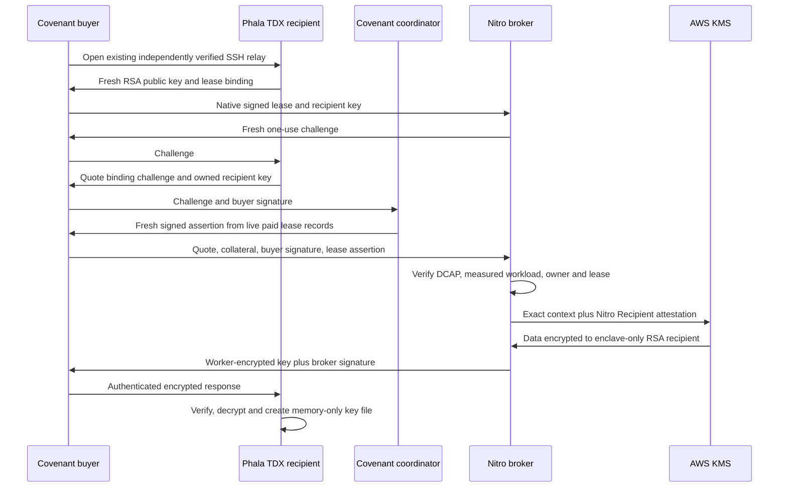

# Covenant application-key broker

Status: **implementation candidate; production key custody is not activated**.
This extends the fresh-VM Phala no-KMS lease path. Buyer-held workspace keys stay
the default. A managed key is a separate explicit choice; nothing automatically
migrates existing keys or enables a new production capability.

Phala hosts the Intel TDX worker with `key_provider:none`. AWS KMS holds the
wrapping root; a measured Nitro Enclave is the only allowed decryption recipient.
The enclave independently verifies the Phala quote, approved native workload,
buyer authorization and current paid lease before re-encrypting a 32-byte
application key to that worker. This does **not** provide Phala boot-disk KMS,
remove trust in AWS, or prevent Covenant's policy administrators from changing
who is authorized. [AWS attested KMS calls](https://docs.aws.amazon.com/kms/latest/developerguide/cryptographic-attestation.html)

## Implemented boundaries

- `covenant-compute-key-broker` embeds its tenant/key registry, ciphertexts,
  coordinator identity, workload rules and response-signing identity at build
  time. Runtime parent input cannot replace policy, supply ciphertext to unwrap,
  change the KMS endpoint or provide a trusted hardware verdict.
- A native policy pins both guest and recipient image digests and the broker's
  response key. It verifies the buyer's original signed job and recomputes the
  complete manifest with the compiled template. This permits fresh job/expiry
  manifests without trusting a coordinator-provided workload-family claim.
  `fixed_qualification_hash` is only an exact-manifest qualification option.
- The isolated recipient owns its RSA-3072 private key and uses raw quote access.
  The existing attestation collector also has `dstack.sock`; the SSH container
  carries public JSON over a fixed Unix socket and never gets that socket.
  The quote binds SHA-512 of the domain-separated canonical
  challenge, including that RSA public key, tenant, key, buyer and lease.
- Real Intel DCAP verification checks vendor signatures, collateral time, RTMR
  replay, compiled OS launch policy, explicit provider `none`, exact Compose
  hash and quoted app/instance identity. Test hardware substitutions exist only
  in test builds. Memory mount/no-swap guards run before collection and delivery.
- The coordinator's opt-in `COVENANT_COMPUTE_KEY_BROKER_IDS` route signs claims
  built from its healthy durable journal, original signatures, currently funded
  unsettled lease, current hardware evidence and a final state re-read. It does
  not sign arbitrary caller claims. An already-issued assertion can remain usable
  for up to 30 seconds after a close; this is bounded freshness, not instant
  revocation of keys already delivered.
- Challenges expire within 60 seconds and are consumed before verification. A
  private, non-serializable authorization permit preserves monotonic deadlines
  across KMS calls. Invalid authorization causes no KMS call. SDK retries are
  disabled; failed, timed-out or ambiguous operations are never silently retried.
- KMS plaintext is available only inside Nitro. The SDK checks the exact root
  ARN, symmetric algorithm and absence of the normal plaintext response. The
  application key is re-encrypted using RSA-OAEP-SHA256 with a challenge-specific
  label. The guest verifies a pinned Ed25519 signature before decryption: public
  recipient encryption alone would allow host-injected replacement keys.

The guest creates `/workspace/.covenant-app-key` once with mode 0600 using
directory-relative `O_EXCL` and `O_NOFOLLOW`; it refuses overwrite. The workspace
is memory-backed and swap must be disabled. Rust key buffers are zeroizing;
Python immutable bytes cannot promise immediate cryptographic zeroization.
Guest/process teardown and the separately qualified fresh-VM lifecycle remain
part of the operational boundary. Delivered keys cannot be recalled.

## Source and diagnostic interfaces

- Broker core/runtime: `agent-os/crates/covenant-compute-key-broker/`.
- Guest recipient and fixed SSH bridge: `deploy/compute-key-broker/guest/`.
- HTTP parent relay: `deploy/compute-key-broker/parent_gateway.py`. It binds only
  to `127.0.0.1`, gets short-lived parent credentials exclusively through IMDSv2,
  and forwards only public challenge/release operations to a bounded Nitro
  process. Its two sessions are capped and a release consumes its session before
  I/O. Put it behind separately reviewed authenticated HTTPS ingress; it is not a
  public internet server or durable audit service.
- Coordinator: `POST /federation/key-broker/:job/lease-assertion`, body
  `{challenge,buyer_authorization}`. Disabled unless broker IDs are configured.
- Parent API: `POST /v1/challenge` accepts `ChallengeRequest` and returns
  `{session_id,challenge}`. `POST /v1/release` accepts `{session_id,request}` and
  returns `SignedReleaseResponse`. Neither route accepts credentials or policy.

The offline `prepare-phala-ephemeral` command accepts an optional
`--application-key-recipient FILE`. The JSON has `protocol_version:1`, `broker_id`,
`broker_response_pubkey_b58`, `tenant_id`, `key_id`, `key_version`, `purpose` and
`recipient_image_digest`. Omitting it preserves the previous manifest and signed
wire representation. Supply only independently enrolled response keys and
reviewed image digests; no production defaults are supplied.

The `deliver-phala-key` diagnostic uses an already purchased, active lease and
requires its original `--envelope`, `--ssh-key`, `--broker` HTTPS origin and an
independently pinned `--coordinator-pubkey`. It creates no lease, funding or stake.
It consumes the lease's single SSH connection and reports a receipt without
printing the key. Do not probe before delivery or retry an uncertain result.
This command qualifies key delivery; running a persistent application with the
delivered key and restoring an encrypted workspace require separate integration.

## Enrollment and image builds

See [AWS foundation and activation gates](compute-key-broker-aws.md) and
[independent Nitro enrollment](../deploy/compute-key-broker/enrollment/README.md).
The response seed is generated ciphertext-only under a separate reserved context.
The foundation starts in `provision_only`, with null enclave measurements and an
unconditional decrypt deny. Actual enrollment measurements are admitted only in
`signing_enrollment`, which rejects application-key use. The final `service`
policy replaces the enrollment measurement after independent verification.
An enrollment-only EIF derives its public key and emits a nonce-bound Nitro proof.
Only independent proof verification permits that public key to enter the final
service/guest policy. Retire the enrollment PCR authorization before activation.

Build the broker with `--features nitro` and a private build-time
`COVENANT_KEY_BROKER_POLICY` file. An ordinary build has an empty embedded policy
and cannot serve. The image Dockerfile expects a private `broker-policy.json`
build input; use an isolated context containing only the exact reviewed tracked
source and this file. Keep real policies and account identifiers outside Git.
`test-build-policy.json` contains deliberately fake images, account and KMS bytes;
CI uses it only to compile images. It can never qualify a deployment.

`check-policy FILE` validates structure and cross-pins, not KMS authorization.
`serve` and `enroll-signing` require the Nitro feature, embedded policy and actual
NSM device. The enclave entrypoint forwards KMS TLS unchanged through parent CID
3, port 8000, preserving the real regional AWS hostname and certificate checks.
The parent must provide a reviewed, destination-limited vsock proxy and valid
enclave UTC for AWS TLS/SigV4; these still require real hardware acceptance.

## Qualification status

Offline tests cover tenant/owner/version/workload attacks, replay, expiry,
coordinator journal/escrow decisions, real RSA and Ed25519 operations, synthetic
CMS, guest mount/IPC checks, bounded socket forwarding, enrollment PKI/COSE
attacks, and generated AWS policy structure. Mocks and synthetic PKI are clearly
separated from production verification. These are source tests, not a live Nitro
or Phala round trip. Linux image/NSM compilation runs in the dedicated CI workflow.

Production remains disabled pending AWS account verification and inventory,
approved infrastructure/cost scope, actual image/PCR enrollment, live allow/deny
tests, a new explicitly authorized paid Phala acceptance, independent security
review, durable release audit, governed policy updates/revocation, two-AZ failure
tests, rotation and recovery drills. Immutable embedded policy avoids trusting
host storage but does not by itself provide an operational policy rollout system.
The retained S3/DynamoDB foundation is not yet a verified runtime audit/version
authority. Current served trust remains **Open**. No production key, AWS resource,
paid lease, deployment or public capability is activated by this change.
